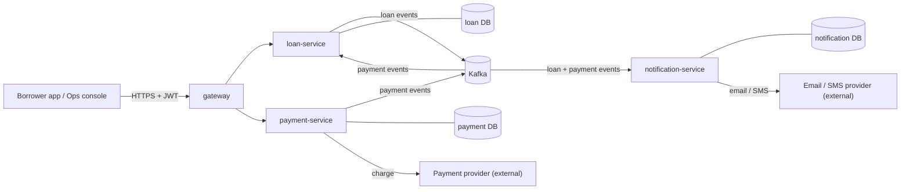

# Mini Lending Platform: System Design

Status: **draft v1**. Only `payment-service` has code. `gateway`, `loan-service`, and `notification-service` are empty folders. Items marked *(assumption)* are defaults I chose and should be confirmed.

## 1. Scope

A platform where borrowers apply for loans, receive disbursements, and repay in instalments. Operators review applications and monitor repayments. Money is INR (ISO 4217 `INR`), stored as `NUMERIC(19,4)`, and all timestamps are UTC (`TIMESTAMPTZ`).

**Out of scope for v1:** credit scoring, KYC vendor integration, collections workflows, multi-currency, multi-tenant operators.

## 2. Services

| Service | Responsibility | Owns data | Status |
|---|---|---|---|
| **gateway** | Single entry point. TLS termination, JWT validation, routing, rate limiting, correlation IDs. | Redis (rate-limit counters) | Empty |
| **loan-service** | Loan applications, approval, disbursement instructions, repayment schedule, loan status. | `loans` DB | Empty |
| **payment-service** | Repayment payments to the provider. Idempotent create, state machine, reconciliation of unknown outcomes. | `payments` DB | Started: domain code removed, config and migration present |
| **notification-service** | Sends emails/SMS/push from domain events. Templates, retries, opt-outs. | `notifications` DB | Empty |

Each service has its own database. Services never read another service's tables. Data is shared through APIs or events.

On the shared Postgres instance (`lending-postgres`) each service gets its own database user and database (`loan`, `payment`, `notification`). This is a deployment choice; the rule is ownership, not instance count.

### Stack (assumption)
- Java 17, Spring Boot 4.1.x, Spring MVC, Spring Data JPA, Flyway, Micrometer/Prometheus, Testcontainers.
- Kafka (KRaft, 4.x) for events, Redis for gateway rate limiting, Postgres 18 for storage.

## 3. Context



## 4. Core flows

### 4.1 Loan application → disbursement
1. Borrower submits an application via `gateway` → `loan-service` (`POST /loans`). Status `APPLIED`.
2. Ops approves (`POST /loans/{id}/approve`). Status `APPROVED`. Loan-service writes the repayment schedule in the same transaction.
3. Disbursement: loan-service emits `LoanApproved`. The disbursement itself is a payout instruction to the provider, which is out of scope for v1; the platform records it as `DISBURSED` once the provider confirms. *(assumption)*
4. Loan becomes `ACTIVE` and notification-service sends a confirmation.

Loan states: `APPLIED → APPROVED → DISBURSED → ACTIVE → CLOSED`, plus `REJECTED` (from `APPLIED`) and `DEFAULTED` (from `ACTIVE`, after N missed instalments).

### 4.2 Repayment (the payment-service flow)
1. Client calls `POST /payments` with `Idempotency-Key`, `loanId`, `userId`, `amount`, and `currency`. The key is required and globally unique (clients use UUIDs).
2. payment-service stores the payment as `CREATED`, then `PROCESSING`, then calls the provider **outside any DB transaction**.
3. Provider result:
   - Approved → `SUCCESS`.
   - Declined → `FAILED` with a reason.
   - Timeout or error → `PENDING`. The outcome is unknown, so it is never retried automatically and never marked `FAILED`.
4. On `SUCCESS` payment-service publishes `PaymentSucceeded` through the **outbox** (same transaction as the state change).
5. loan-service consumes `PaymentSucceeded` and applies it to the schedule (allocating to interest, then principal). It publishes `RepaymentApplied`.
6. notification-service sends a receipt.

A repayment that reaches `PENDING` is resolved by reconciliation (see §7). It is never double-charged: a retry with the same key returns the existing payment.

### 4.3 Missed instalment → default
loan-service runs a daily job that marks instalments overdue. After N consecutive misses (configurable, default 3 *(assumption)*) the loan becomes `DEFAULTED` and emits `LoanDefaulted`. notification-service notifies the borrower and ops.

## 5. Events

Topics, keyed by `loanId` so events for one loan stay ordered within a partition.

| Topic | Producer | Consumers | Events |
|---|---|---|---|
| `loan.events.v1` | loan-service | notification-service | `LoanApplied`, `LoanApproved`, `LoanRejected`, `LoanActivated`, `LoanClosed`, `LoanDefaulted` |
| `payment.events.v1` | payment-service | loan-service, notification-service | `PaymentSucceeded`, `PaymentFailed`, `PaymentPending` |

Envelope (every event):
```json
{
  "eventId": "uuid",
  "eventType": "PaymentSucceeded",
  "occurredAt": "2026-10-11T08:00:00Z",
  "aggregateId": "loan or payment id",
  "correlationId": "uuid",
  "schemaVersion": 1,
  "payload": { }
}
```

Rules:
- **Outbox**: producers write the event row in the same DB transaction as the state change. A relay publishes it to Kafka. This prevents "state changed but event lost" and "event sent but state rolled back".
- **At-least-once delivery**: consumers dedupe on `eventId` (stored in a `processed_events` table per consumer).
- **Schema evolution**: additive changes only within a version. Breaking changes get a new topic version (`.v2`).

## 6. API conventions

- Base path `/api/v1/<resource>`. JSON. camelCase fields.
- Money as a string-safe decimal (`"1500.5000"`), currency as ISO 4217.
- Errors as RFC 9457 `application/problem+json` with a stable `type` URI.
- Idempotency: every create that moves money requires `Idempotency-Key`. Same key + same body returns the original (200). Same key + different body returns 409.
- Pagination: `page` and `size` (max 100) with a stable sort (`createdAt desc, id desc`).
- Auth: JWT at the gateway. Services trust the gateway over the private network and check roles (`BORROWER`, `OPS`) for admin endpoints. *(assumption)*
- Correlation: `X-Correlation-Id` is accepted or generated at the gateway, logged, and propagated to events.

## 7. Failure handling

| Failure | Behaviour |
|---|---|
| Provider timeout / 5xx | Payment → `PENDING`. Reconciliation job queries the provider by payment ID and resolves to `SUCCESS` or `FAILED`. Customer sees "processing". |
| Crash mid-charge | Sweeper moves `PROCESSING` rows older than 5 min to `PENDING` (implemented in the earlier payment-service draft). |
| Kafka unavailable | Outbox keeps events. Relay retries with backoff. No state is lost. |
| Consumer bug or poison message | Retries with exponential backoff, then dead-letter topic (`*.dlt`). Alert on DLT growth. |
| DB unavailable | Requests fail with 503. Health readiness goes DOWN so the gateway stops routing. |
| Duplicate request | Idempotency key returns the original result. |

## 8. Data model (summary)

**payment DB** (existing migration `V1__create_payments.sql`): `payments` with `id`, `idempotency_key` (unique), `request_hash`, `loan_id`, `user_id`, `amount NUMERIC(19,4)`, `currency CHAR(3)`, `status`, `failure_reason`, `version`, timestamps. Plus `outbox_events`.

**loan DB**: `loans` (`id`, `user_id`, `principal`, `annual_rate`, `tenor_months`, `status`, `version`, timestamps), `repayment_schedule` (`loan_id`, `instalment_no`, `due_date`, `principal_due`, `interest_due`, `principal_paid`, `interest_paid`, `status`), `outbox_events`, `processed_events`.

**notification DB**: `notifications` (`id`, `recipient`, `channel`, `template`, `status`, `attempts`, timestamps), `processed_events`.

**Money rules:** interest uses the reducing-balance method, rounded half-even to 2 decimals per instalment *(assumption)*. Allocation order for a repayment: interest first, then principal.

## 9. Security

- TLS at the gateway (ALB / Caddy / nginx on EC2). Internal traffic on a private Docker network.
- Postgres, Kafka, Redis, and Kafka UI bind to `127.0.0.1` only (already in `docker-compose.yml`). Access from a laptop goes through an SSH tunnel.
- Secrets come from environment variables or a secrets manager. Never in git. `.env` is gitignored.
- Least-privilege DB users per service.
- PII (names, phone, bank details) is not logged. Amounts and IDs are logged.
- Rate limiting at the gateway (Redis) on auth and payment endpoints.

## 10. Observability

- Actuator on every service: `/actuator/health/liveness`, `/readiness`, `/prometheus`.
- Structured JSON logs with `correlationId`, `paymentId`/`loanId`, and `eventId`.
- Business metrics: `payments.processed{status}`, `loans.applied`, `repayments.amount`, outbox lag, consumer lag, DLT count.
- Alerts (v1): `PENDING` payments older than 15 min, DLT count > 0, outbox lag > 1 min, 5xx rate > 1% on the gateway.

## 11. Deployment

- **Local:** `docker compose up` for infra. Services run with `mvn spring-boot:run` (or in compose, once images are built).
- **Target:** one EC2 host running `docker compose` (as the compose file is already written for), behind a TLS terminator. Upgrade path to ECS or Kubernetes if traffic demands it.
- Each service has a `Dockerfile`, a `/readiness` health check, and graceful shutdown.
- DB migrations: Flyway runs at service startup. Migrations are forward-only and backward compatible with the previous app version (expand, then contract).

## 12. Testing strategy

- Unit tests: domain rules (state machines, schedule math, fingerprinting).
- Integration tests: Testcontainers (Postgres 18, Kafka) for repositories, outbox relay, and consumers.
- Contract tests: event schemas (JSON Schema per topic) checked in CI.
- End-to-end: one scripted scenario (apply → approve → repay → default) against docker compose.

## 13. Build order

1. **Shared conventions** (a small library or docs): event envelope, error format, idempotency filter, outbox table and relay.
2. **payment-service**: rebuild the API, state machine, outbox, sweeper, tests.
3. **loan-service**: applications, approval, schedule, repayment allocation, default job.
4. **gateway**: routing, JWT, rate limiting.
5. **notification-service**: consume events, templates, retries, DLT.
6. **Reconciliation job** for `PENDING` payments (needs a real provider API).
7. End-to-end test, then EC2 deployment.

## 14. Open questions

1. **Business rules:** interest method (reducing balance assumed), penalty rules, default threshold (3 missed assumed), grace periods.
2. **Disbursement:** does the platform pay out to the borrower via the provider, or is that handled outside the system?
3. **Payment provider:** which PSP? Its API determines the reconciliation and webhook design.
4. **Auth:** own identity service, or an external IdP (Cognito / Auth0 / Keycloak)?
5. **Notification channels:** email only for v1, or SMS too?
6. **Roles:** how many operator roles and what each can approve.
7. **Scale targets:** expected loans and repayments per day, to size Kafka partitions and DB.
